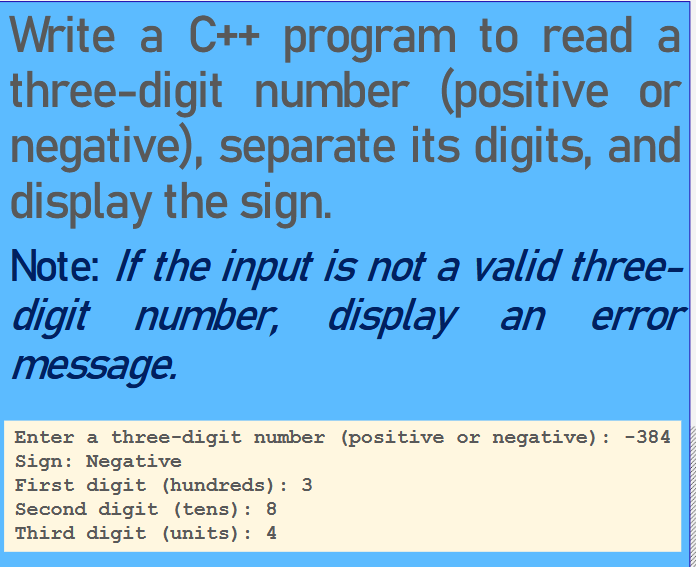

# semester 2

## 1/ semester 1 revision question:

answer: [here](sem_1_review.cpp)
---
## 2/ factorial finder:

answer: [here](factorial.cpp)
---
## 3/ three homeworks:

answers:
-[1](<print real nums.cpp>)
-[2](average.cpp)
-[3](<print terms.cpp>)

